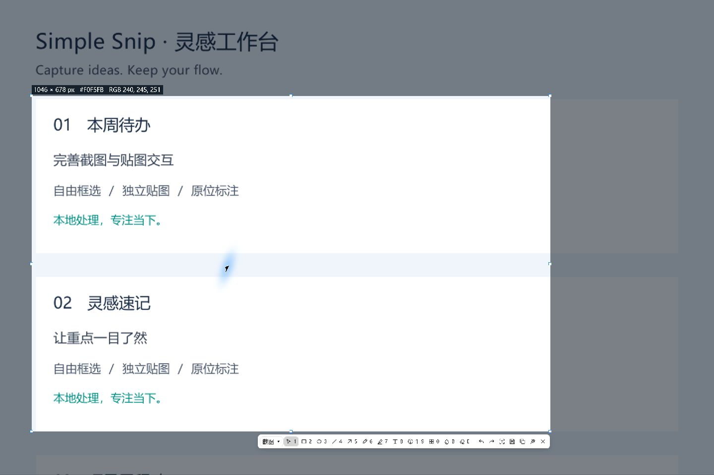
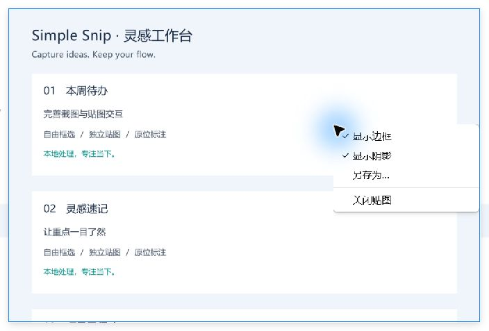
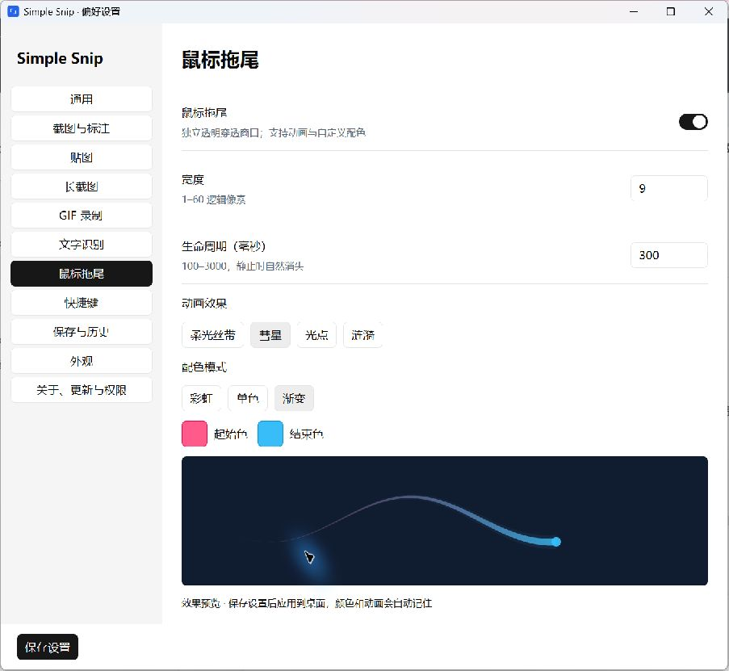
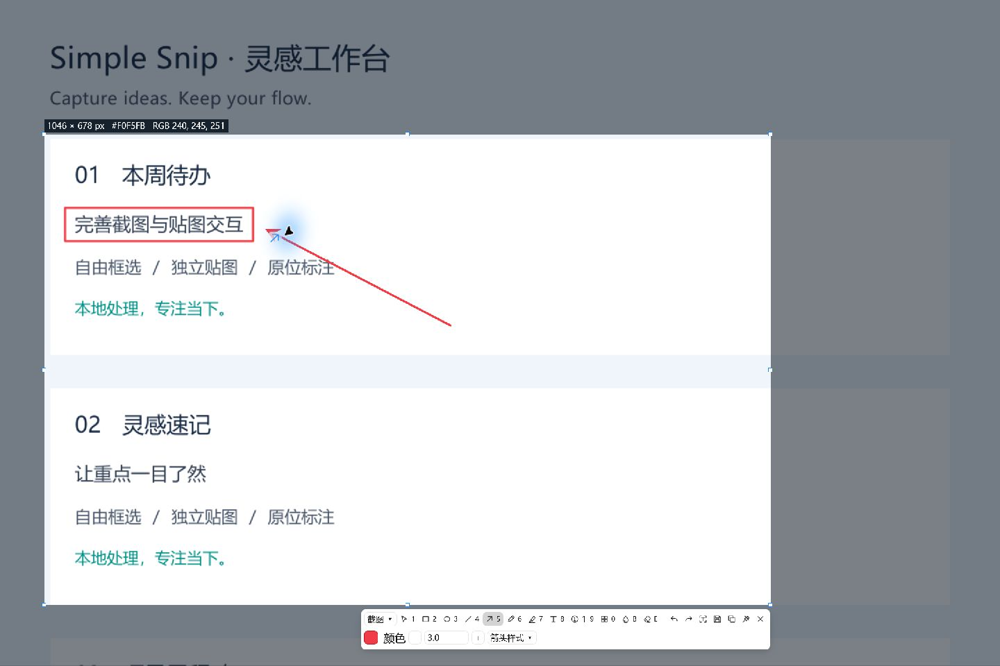
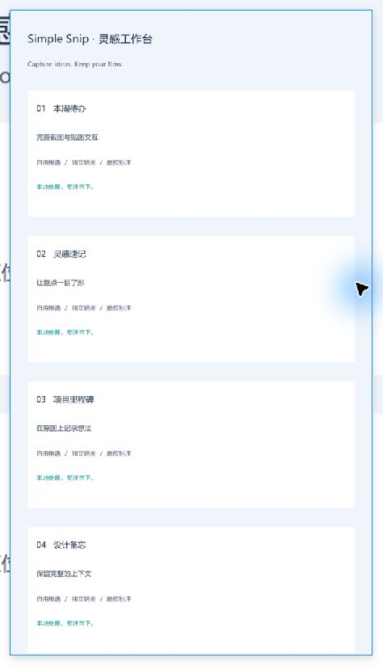
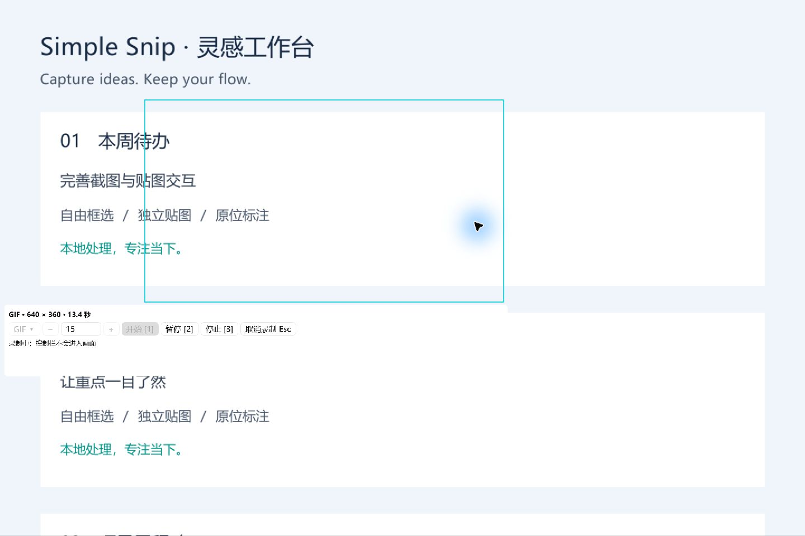

# Simple Snip

轻巧的本地截图与贴图工具，让截图、标注和参考资料留在工作现场。支持 Windows 与 macOS。

## 核心优势

- **少打断，快记录**：快捷键截图，原位标注，一键贴回桌面。
- **本地处理**：截图、OCR、长截图和 GIF 编码在本机完成。
- **桌面即工作台**：多张独立贴图，支持缩放、透明度、穿透及动态 GIF 播放。
- **按习惯使用**：记住各工具的颜色、尺寸和样式，快捷键冲突在设置中查看并自动重试。

## 主要功能

### 截图

按 **F1** 框选区域或吸附窗口，拖动边缘微调选区，直接复制、保存或进入标注；图片复制成功后自动关闭截图界面。

### 贴图

按 **F3** 将剪贴板中的图片、文本、富文本和表格固定在桌面，保留常见字体、颜色与表格样式；截图编辑时直接固定当前选区。支持拖动、缩放、旋转、透明度及鼠标穿透，右键切换边框、阴影或另存为。GIF 文件支持动态贴图播放。

### 鼠标拖尾

柔光丝带、彗星、光点、涟漪四种动画，搭配彩虹、单色或双色渐变。通过颜色选择器调整颜色与透明度，自定义宽度和消失时间，设置自动记忆。

### 标注

矩形、椭圆、箭头、画笔、高亮、文本、序号、马赛克与模糊，支持样式调整、撤销重做和配置记忆。OCR 保留原图，直接拖选文字并按 **Ctrl/Cmd+C** 复制。

### 长截图

框选区域后切换长截图，随滚动拼接连续内容；支持暂停、继续和自动向下滚动，完成后继续标注或贴图。

### GIF 录制

框选区域录制 GIF，控制栏紧贴选区右下角。支持帧率调整、暂停与继续；停止后先保存会话临时结果，可在原区域预览，再选择位置保存。

## 设置与 macOS 安装

偏好设置修改后自动保存；文本输入停止约半秒后生效，无效输入会提示并保留原设置。

当前 `_unsigned` macOS 下载包未经过 Apple 公证，可能显示“Apple 无法验证”提示。这与录屏权限不同；正式修复需要 Developer ID 签名与公证，见 [发布签名配置](docs/MACOS_SIGNING.md)。
